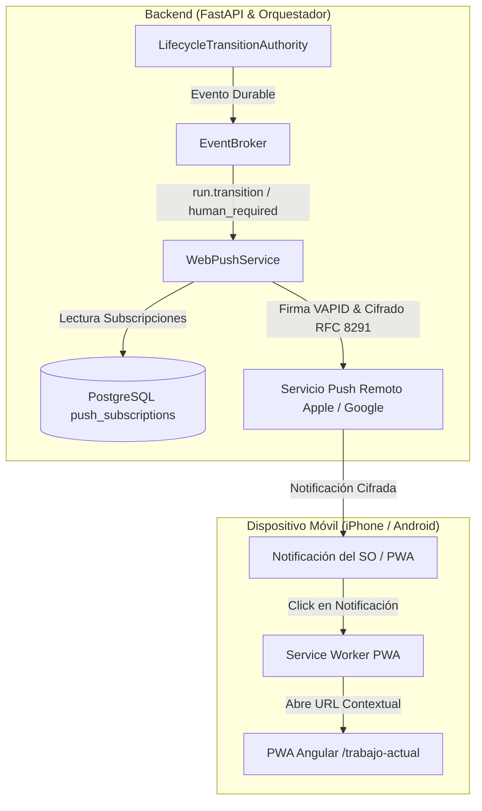

# Design: F11 — Supervisión móvil proactiva y notificaciones Web Push

## Architecture & Integration

## Detailed Decisions

### 1. Gestión Criptográfica VAPID
- **Configuración:** Las claves VAPID se leen de `MINIME_VAPID_PUBLIC_KEY`, `MINIME_VAPID_PRIVATE_KEY` y `MINIME_VAPID_CLAIM_EMAIL`.
- **Generación Automática:** Si no están en variables de entorno, `WebPushService` genera y persiste un par criptográfico VAPID en `/var/lib/minime/secrets/vapid_keys.json` con permisos restrictivos `0600`.
- **Exposición Pública:** El endpoint `GET /api/v1/push/vapid-public-key` devuelve `{ "public_key": "..." }` a operadores autenticados.

### 2. Modelo de Datos PostgreSQL (`push_subscriptions`)
- Se implementa la entidad `PushSubscription` en SQLAlchemy y la migración correspondiente en Alembic:
  - `id`: UUID (Primary Key)
  - `operator_id`: str (Index, asociado a la identidad del operador autenticado)
  - `endpoint`: str (Unique, URL del gateway de Apple/Google)
  - `p256dh`: str (Clave pública del cliente ECDH)
  - `auth`: str (Secreto de autenticación compartido)
  - `device_label`: str (Etiqueta descriptiva: e.g. "iPhone Safari", "Android Chrome")
  - `is_active`: bool (Default True; cambia a False tras errores 404/410)
  - `category_stage_transitions`: bool (Default True)
  - `category_human_required`: bool (Default True)
  - `category_terminal_outcomes`: bool (Default True)
  - `created_at` / `updated_at` / `last_success_at`: datetime

### 3. Servicio de Despacho (`WebPushService`)
- Desacoplado: el envío push se ejecuta en tareas en segundo plano (`asyncio` / background task).
- Manejo de respuestas del gateway:
  - HTTP 201: éxito; actualiza `last_success_at`.
  - HTTP 404 / 410 (Gone): la suscripción expiró o fue revocada en el navegador; se marca `is_active = False` inmediatamente.
  - Fallo temporal (HTTP 429 / 5xx): se registra diagnóstico sin abortar ni reintentar indefinidamente.
- Principio fail-safe: **un fallo en la entrega push jamás detiene, invalida ni interrumpe la transición de un Run en el orquestador**.

### 4. Integración en el Frontend Angular
- `PushNotificationService`:
  - Detecta si el navegador soporta `Notification` y `serviceWorker`.
  - Consulta permiso actual (`default`, `granted`, `denied`).
  - Solicita permiso mediante gesto explícito de usuario.
  - Registra la suscripción con `pushManager.subscribe({ userVisibleOnly: true, applicationServerKey })`.
  - Envía la suscripción al backend `POST /api/v1/push/subscriptions`.
- Control de interfaz:
  - Añadir en el encabezado o perfil un modal/popover de configuración Web Push:
    - Estado de permiso y suscripción.
    - Checkboxes para categorías: Transiciones de etapa, Atención humana, Resultados finales.
    - Botón "Enviar notificación de prueba" llamando a `POST /api/v1/push/test`.
- Manejo de click en Service Worker:
  - Al pulsar la notificación, el Service Worker ejecuta `clients.openWindow(data.url)` apuntando a `/trabajo-actual?run={run_id}&project={project_id}`.

### 5. Deduplicación y Aislamiento
- Cada transición observable emite como máximo una notificación push por instalación.
- La identidad de operador garantiza que una cuenta no reciba alertas de proyectos a los que no tiene acceso.
- Los payloads solo contienen título, mensaje descriptivo y URL contextual relativa; nunca contienen credenciales, tokens ni datos sensibles.
